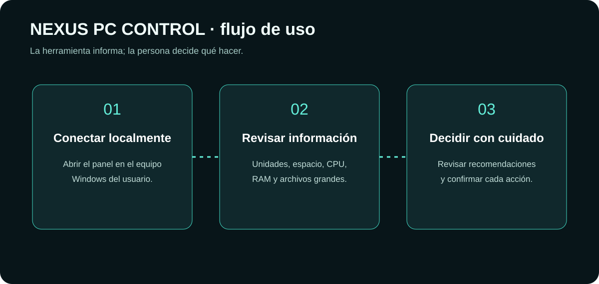

<div align="center">


# NEXUS PC CONTROL

### Diagnóstico local. Información clara. Decisiones seguras.

**Panel local para consultar información del equipo Windows y revisar posibles tareas de mantenimiento.**

[📂 Repositorio](https://github.com/JOSEFRO/NEXUS-PC-CONTROL) · [⬇️ Descargar código ZIP](https://github.com/JOSEFRO/NEXUS-PC-CONTROL/archive/refs/heads/main.zip)

</div>

## ¿Qué es NEXUS?

NEXUS PC CONTROL es una herramienta local para Windows. Presenta información del equipo en una interfaz web que se sirve únicamente en el propio dispositivo. No es un servicio remoto ni debe exponerse a Internet.

## Flujo de uso



1. Inicia el programa en tu equipo Windows.
2. Abre el panel local en el navegador.
3. Consulta unidades, espacio, CPU, memoria y resultados de análisis.
4. Revisa la información antes de tomar cualquier decisión.
5. Confirma manualmente cualquier acción disponible.

## Funciones actuales documentadas

- Consulta de todas las unidades detectadas, con espacio utilizado y libre.
- Análisis aproximado de carpetas habituales del perfil del usuario.
- Búsqueda manual de archivos grandes; informa resultados, no los elimina.
- Revisión limitada de ubicaciones temporales predefinidas.
- Lectura de CPU, memoria RAM y versión del entorno.
- Interfaz en español y diseño adaptable.

## Seguridad por diseño

- El servidor escucha en `127.0.0.1:8765`, no en una interfaz pública.
- Los nombres y rutas se representan como texto, no como HTML ejecutable.
- Validación de host local, límites de solicitudes y validación de datos.
- La limpieza es selectiva y requiere revisión y confirmación.
- No elimina documentos, descargas, fotos, proyectos, juegos, máquinas virtuales ni archivos personales.

**Importante:** no ejecutes acciones de mantenimiento si no entiendes qué elemento se va a modificar. Mantén copias de seguridad de los datos importantes.

## Requisitos

- Windows 10 u 11.
- Python 3.10 o superior.
- Conexión inicial para instalar Flask y psutil.

## Inicio rápido

1. Descarga y extrae el ZIP.
2. Ejecuta `INICIAR.bat`.
3. Si el navegador no se abre automáticamente, visita `http://127.0.0.1:8765`.

También puedes iniciarlo desde PowerShell:

```powershell
py -m venv .venv
.venv\Scripts\activate
py -m pip install -r requirements.txt
py app.py
```

## Tecnologías

Python · Flask · psutil · HTML · CSS · JavaScript

## Límites conocidos

- No reemplaza las herramientas oficiales de diagnóstico y mantenimiento de Windows.
- No realiza benchmarks ni promete aumentar el rendimiento del equipo.
- No se ha verificado un instalador empaquetado ni la compatibilidad con todas las variantes de Windows.
- Las funciones de limpieza requieren pruebas adicionales en entornos controlados antes de considerarse listas para producción.

## Licencia

No se ha añadido una licencia de reutilización. El código y los recursos permanecen reservados a su propietario salvo autorización expresa.
