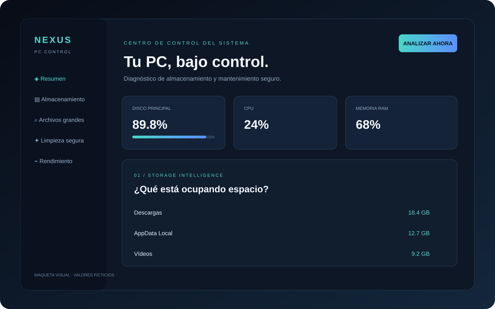

# NEXUS PC CONTROL

<p align="center">
  
</p>

**Diagnóstico local de Windows, almacenamiento y recursos del sistema.**

NEXUS PC CONTROL ayuda a identificar qué carpetas y archivos ocupan espacio antes de decidir qué limpiar. La herramienta se ejecuta localmente y el panel se abre en el navegador.

[Descargar código ZIP](https://github.com/JOSEFRO/NEXUS-PC-CONTROL/archive/refs/heads/main.zip) · [Reportar un problema](https://github.com/JOSEFRO/NEXUS-PC-CONTROL/issues)

## Funciones

- Resumen de unidades y espacio disponible.
- Estimación de tamaño de carpetas habituales del usuario.
- Búsqueda de archivos grandes dentro del perfil.
- Vista previa de categorías temporales permitidas para limpieza.
- Métricas básicas de CPU y memoria RAM.
- Interfaz web en español.

## Vista previa

La imagen de `docs/images/` es una maqueta conceptual del panel. La apariencia y los valores pueden diferir de la aplicación ejecutándose en tu PC.

## Requisitos

- Windows 10 u 11.
- Python 3.10 o superior, añadido al PATH.
- Conexión a Internet solo para instalar dependencias la primera vez.

## Descarga e instalación

### Opción A — Descargar ZIP

1. Abre [NEXUS PC CONTROL en GitHub](https://github.com/JOSEFRO/NEXUS-PC-CONTROL).
2. Pulsa **Code → Download ZIP**.
3. Extrae la carpeta en una ubicación fácil de encontrar.
4. Haz doble clic en `INICIAR.bat`.
5. Espera a que se cree el entorno virtual y se instalen las dependencias.
6. Abre `http://127.0.0.1:8765` si no se abre automáticamente.

### Opción B — Clonar con Git

```bash
git clone https://github.com/JOSEFRO/NEXUS-PC-CONTROL.git
cd NEXUS-PC-CONTROL
INICIAR.bat
```

## Uso recomendado

1. Pulsa **Analizar ahora**.
2. Revisa las carpetas ordenadas por tamaño.
3. Busca archivos grandes y comprueba su ruta y uso antes de tomar una decisión.
4. En Limpieza segura, selecciona únicamente categorías temporales que entiendas.
5. Confirma la limpieza solo después de revisar la selección.
6. Vuelve a analizar para comparar el espacio disponible.

## Seguridad y límites

- El panel debe permanecer enlazado a `127.0.0.1`; no lo expongas directamente a Internet.
- El análisis puede omitir archivos protegidos o bloqueados.
- Los tamaños de carpetas pueden solaparse si una carpeta contiene otra incluida en el informe.
- No borres manualmente archivos de Windows, System32, Program Files o carpetas de controladores.
- No elimines juegos, partidas guardadas, proyectos o máquinas virtuales sin verificar primero su contenido.
- La limpieza temporal no sustituye una copia de seguridad.
- La elevación de permisos no es necesaria para el análisis normal. Ejecuta como administrador solo si una función documentada lo requiere.

## Solución de problemas

**Python no aparece:** instala Python desde [python.org](https://www.python.org/downloads/) y activa la opción para añadirlo al PATH.

**El puerto 8765 está ocupado:** cierra la otra aplicación que lo use antes de iniciar NEXUS.

**Algunos archivos no se pueden leer:** es normal que Windows proteja archivos en uso o de otras cuentas.

**El panel no abre:** confirma que la ventana de la terminal siga ejecutándose y visita `http://127.0.0.1:8765`.

## Desarrollo

```bash
py -m venv .venv
.venv\Scripts\activate
py -m pip install -r requirements.txt
py app.py
```

## Estado

Versión inicial/prototipo. Aún requiere pruebas en distintos equipos Windows, validación de permisos, pruebas de seguridad y empaquetado de instalador antes de considerarse una herramienta de mantenimiento de producción.

## Licencia

No se ha añadido una licencia de reutilización. El proyecto permanece reservado a su propietario salvo autorización expresa.
