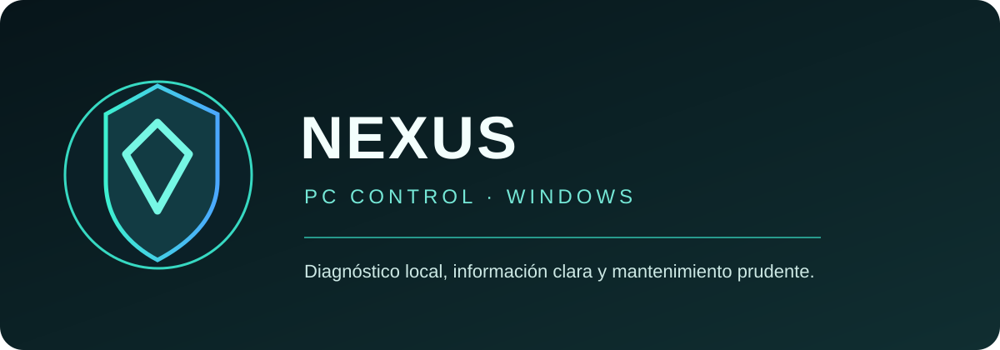

<div align="center">



# NEXUS PC CONTROL

### Diagnóstico local. Información clara. Decisiones seguras.

**Panel de diagnóstico para Windows con análisis de almacenamiento en segundo plano.**

[Repositorio](https://github.com/JOSEFRO/NEXUS-PC-CONTROL) · [Descargar ZIP](https://github.com/JOSEFRO/NEXUS-PC-CONTROL/archive/refs/heads/main.zip) · [Historial de cambios](https://github.com/JOSEFRO/NEXUS-PC-CONTROL/commits/main)

<sub>Versión de desarrollo 2.0 · Proyecto de JOSEFRO</sub>

</div>

## ¿Qué es NEXUS?

NEXUS PC CONTROL es una aplicación local para Windows. Abre un panel web en tu propio equipo para consultar unidades, revisar el almacenamiento y observar recursos del sistema. La interfaz se sirve en `127.0.0.1:8765`; no es una aplicación web alojada para analizar equipos por Internet.

## Funciones disponibles

### Diagnóstico del equipo
- Detección de unidades montadas y capacidad utilizada/libre.
- Identificación de la unidad del sistema cuando Windows la informa.
- Consulta de CPU, memoria RAM y versión del entorno.

### Storage Intelligence 2.0 — P0 y P1
- Escaneo recursivo de carpetas habituales del perfil, sin el límite fijo anterior de cuatro niveles.
- Búsqueda de archivos grandes con umbral configurable.
- Análisis en segundo plano para mantener la interfaz receptiva.
- Contadores de archivos, carpetas, bytes observados y errores.
- Cancelación cooperativa y disponibilidad de resultados parciales.
- Informe de cobertura, carpetas excluidas, errores y enlaces simbólicos omitidos.
- Resultados ordenados por tamaño.

### Explorador de almacenamiento y papelera segura
- Los archivos seleccionados desde las ubicaciones admitidas se envían a la papelera del sistema mediante `Send2Trash`, en lugar de eliminarse permanentemente.
- La interfaz informa cuántos archivos se enviaron a la papelera; no afirma que el espacio se haya liberado hasta que el usuario vacíe la papelera.
- La operación vuelve a validar la ubicación y el tipo de archivo antes de enviarlo a la papelera.

### Mantenimiento selectivo
- Presenta ubicaciones temporales admitidas por la aplicación.
- Requiere selección y confirmación manual.
- No convierte el análisis de almacenamiento en una orden de borrado.

## Inicio rápido en Windows

**Requisitos:** Windows 10/11, Python 3.10 o superior y conexión inicial para instalar dependencias.

1. Descarga el ZIP del repositorio y extrae su contenido.
2. Ejecuta `INICIAR.bat`.
3. Espera a que se instalen las dependencias y se inicie el servidor.
4. Abre [http://127.0.0.1:8765](http://127.0.0.1:8765) si el navegador no se abre automáticamente.

También puedes iniciarlo desde PowerShell:

```powershell
py -m venv .venv
.venv\Scripts\activate
py -m pip install -r requirements.txt
py app.py
```

## Arquitectura y API de análisis

Los trabajos de análisis se administran en el proceso local de Flask:

| Método | Ruta | Uso |
|---|---|---|
| POST | `/api/storage/scans` | Inicia un análisis de perfil o de archivos grandes |
| GET | `/api/storage/scans/{scan_id}` | Consulta estado, contadores y resultados |
| POST | `/api/storage/scans/{scan_id}/cancel` | Solicita la cancelación |

Los estados incluyen `queued`, `running`, `cancelling`, `cancelled`, `completed`, `completed_with_warnings` y `failed`. El progreso es indeterminado cuando no se conoce el total; los contadores reflejan trabajo observado, no porcentajes inventados.

Consulta la [especificación técnica y hoja de ruta](docs/STORAGE-INTELLIGENCE-2.0.md).

## Seguridad y privacidad

- El servidor escucha exclusivamente en `127.0.0.1`.
- No se debe publicar ni exponer este servidor en una IP pública, túnel o alojamiento web.
- Los análisis de almacenamiento son de solo lectura.
- No se siguen enlaces simbólicos durante el recorrido.
- Los errores y exclusiones se informan para no presentar una cobertura parcial como completa.
- La aplicación no envía nombres de archivos, rutas ni inventarios de discos a servicios externos.
- Las acciones de limpieza disponibles son independientes del escaneo y requieren confirmación.

**Importante:** los tamaños de archivos representan tamaño lógico, no necesariamente espacio físico asignado en NTFS. Los análisis del perfil no equivalen a un inventario completo de todo el disco.

## Actualización visual 2026

La rama `feat/nexus-safe-trash` incorpora una dirección visual oscura con acentos violeta en navegación, tarjetas, indicadores, formularios y paneles. La interfaz sigue siendo una aplicación local de Windows; no se convierte en un servicio web público.

## Validación y estado

- CI de GitHub Actions: pruebas en Ubuntu y Windows. En la última ejecución de esta rama, Ubuntu pasó y Windows detectó una aserción de prueba demasiado estricta por diferencias entre rutas largas y alias 8.3 de Windows. La prueba se ajustó para comparar identidad del archivo; la nueva ejecución queda pendiente de resultado.
- La suite actual contiene 32 pruebas automatizadas. Ubuntu aprobó las 32 en la última ejecución; la validación equivalente en Windows está en curso tras ajustar una aserción que fallaba por alias de rutas 8.3 del runner.
- La CI usa máquinas virtuales. Aún se recomienda validar en equipos físicos Windows 10/11, unidades NTFS secundarias/removibles, perfiles redirigidos y carpetas con permisos restringidos.
- El rediseño visual y el cambio de papelera están en una propuesta de integración; no se consideran publicados hasta completar CI y revisión en un equipo Windows real.
- La versión 2.0 sigue en desarrollo. Las fases de árbol de carpetas, categorías, mapa visual, duplicados y reportes están en la hoja de ruta.

## Tecnologías

Python · Flask · psutil · HTML · CSS · JavaScript · GitHub Actions

## Licencia

No se ha añadido una licencia de reutilización. El código y los recursos permanecen reservados a su propietario salvo autorización expresa.
