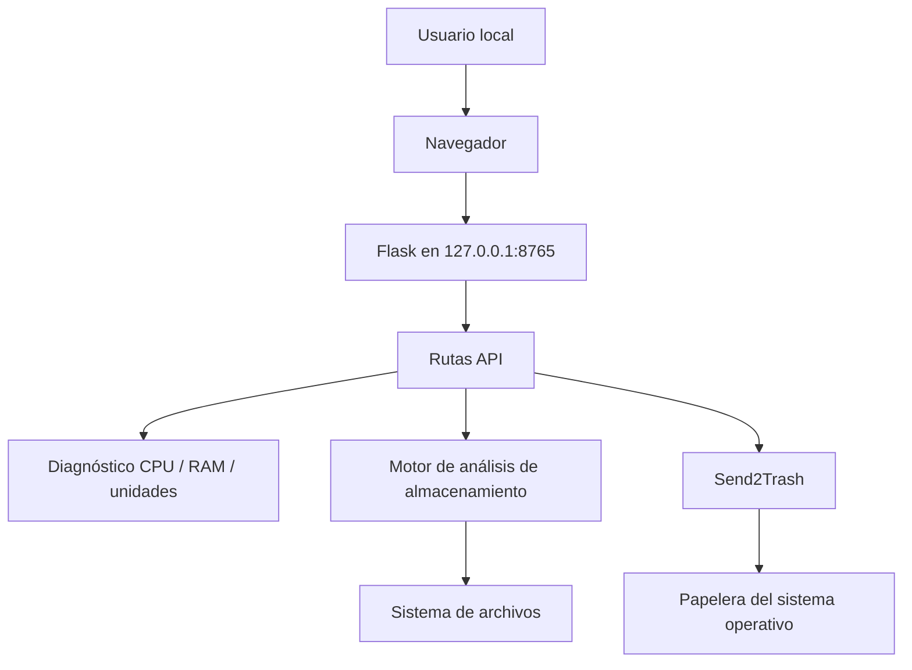

# Arquitectura de NEXUS PC CONTROL

## Vista general

NEXUS se ejecuta localmente en Windows. Flask sirve la interfaz y las rutas API en loopback; los módulos de diagnóstico consultan recursos del equipo.



## Componentes

| Componente | Tecnología | Responsabilidad |
|---|---|---|
| Servidor local | Flask | Entrega la interfaz y procesa solicitudes locales. |
| Métricas | psutil | Consulta recursos del sistema y unidades. |
| Exploración | Python | Recorre rutas admitidas y calcula resultados. |
| Acciones de papelera | Send2Trash | Envía archivos seleccionados a la papelera del sistema. |
| Interfaz | HTML, CSS y JavaScript | Presenta resultados y controles de revisión. |

## Seguridad y límites

- La aplicación se inicia en `127.0.0.1`, no en una interfaz pública.
- Los análisis deben tratarse como operaciones de lectura.
- Se excluyen enlaces simbólicos y rutas no admitidas.
- Las acciones sobre archivos requieren selección y confirmación.
- Enviar a la papelera no significa que el espacio se haya liberado.
- El usuario debe revisar la ruta y el contenido antes de confirmar.
- No se promete cobertura completa del disco: permisos, exclusiones y errores pueden limitar un análisis.

## API de análisis

| Método | Ruta | Propósito |
|---|---|---|
| POST | `/api/storage/scans` | Crear un análisis. |
| GET | `/api/storage/scans/{scan_id}` | Consultar progreso y resultados. |
| POST | `/api/storage/scans/{scan_id}/cancel` | Solicitar cancelación. |

Consultar el detalle de estados, cobertura y cancelación en [Storage Intelligence 2.0](STORAGE-INTELLIGENCE-2.0.md).

## Ejecución

```powershell
py -m venv .venv
.venv\Scripts\activate
py -m pip install -r requirements.txt
py app.py
```

Abrir `http://127.0.0.1:8765`.

## Validación

GitHub Actions automatiza comprobaciones en los entornos configurados por el repositorio. Las pruebas automatizadas no sustituyen la validación manual en equipos Windows reales, especialmente con unidades externas, permisos restringidos y perfiles redirigidos.
